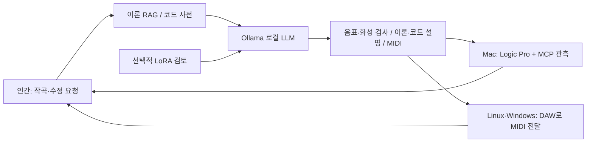

# DeepChord

**Authors / Project credits:** [Hee-sung Kang · 강희성](https://ikoffices.com/) · [Do-won Lee · 이도원](https://music.bugs.co.kr/artist/80353758?wl_ref=list_ar_02_search) · [Sungmo Park · 박성모](mailto:vividsaebom@gmail.com)

[Organization](https://github.com/Sovereign-Music-Lab) · [Website](https://sovereign-music-lab.github.io/) · [DeepChord](https://github.com/Sovereign-Music-Lab/DeepChord) · [Sovereign DAW](https://github.com/Sovereign-Music-Lab/sovaroll-DAW) · [Sovereign Flow](https://github.com/Sovereign-Music-Lab/SovaFlow)

## 초록
[English](README.md) · **한국어**

**Sovereign Music Lab · 로컬의 지식 → 편집 가능한 음악 → 사람의 다음 요청.**

Linux·Windows·macOS에서 사용하는 로컬 피아노 작곡 도구입니다. 공개 이론 RAG와 코드 사전, Ollama 로컬 LLM, 선택적 LoRA, MIDI·설명과 지속 세션을 연결합니다. Mac에서는 Logic Pro와 MCP 상태 관측을 함께 사용할 수 있습니다.

## 목차

- [인간이 계속 주문하는 작곡 루프](#인간이-계속-주문하는-작곡-루프)
- [공개 기초 자산](#공개-기초-자산)
- [설치 — Python 3.11 이상](#설치--python-311-이상)
- [작곡하고 계속 수정](#작곡하고-계속-수정)
- [Logic Pro + MCP — Mac](#logic-pro--mcp--mac)
- [LoRA와 이론 검토](#lora와-이론-검토)
- [개인 RAG (선택)](#개인-rag-선택)
- [피드백·검사·공개 범위](#피드백검사공개-범위)
- [프로젝트와 크레딧](#프로젝트와-크레딧)
- [개발 인계](#개발-인계)

## 인간이 계속 주문하는 작곡 루프



매번 새 주문을 받아 직전 성공 버전을 수정하고, `/quit` 이후에도 같은 이름으로 이어갑니다. 실패는 기록하며 이전 버전을 보존합니다. 대화형 세션은 1–16마디 피아노 스케치이며, 별도의 실험적 전체 곡 명령은 여러 악기 트랙을 생성합니다. 완성곡의 모든 편성·음색·믹스나 Logic 편집을 무인 자동화했다고 주장하지 않습니다.

## 공개 기초 자산

교재와 독립적으로 작성한 **24개 이론 카드 + 32개 간격 공식 × 12근음 = 384개 코드 항목**을 포함합니다. 검색·코드 계산에는 PDF·계정·네트워크가 필요하지 않습니다. 원본 책, OCR, 목차·페이지 위치, 악보와 교재 예제는 포함하지 않습니다.

```sh
deepchord rag '장조 투파이브와 루트리스 보이싱'
deepchord chord 'Cdim7'
deepchord foundation --out /path/to/new/foundation
```

내보내기는 RAG 문서 408개와 한·영 LoRA 예제 816개, 출처·해시 명세를 재현합니다. 소스 TOML·수식과 공개 자료에서의 재생성 방법을 배포합니다. 새 문장·코드는 Apache-2.0이며 음악 이론의 사실 자체에 독점권을 주장하지 않습니다. [기초 자산·권리 구분·반복 루프·운영체제 안내](docs/foundation.ko.md)를 참고하세요.

## 설치 — Python 3.11 이상

Linux/macOS:

```sh
git clone https://github.com/Sovereign-Music-Lab/DeepChord.git
cd DeepChord
python3 -m venv .venv
source .venv/bin/activate
python -m pip install .
deepchord doctor
deepchord demo --out "$HOME/Music/deepchord-demo"
```

Windows PowerShell:

```powershell
git clone https://github.com/Sovereign-Music-Lab/DeepChord.git
cd DeepChord
py -3 -m venv .venv
.venv\Scripts\python.exe -m pip install .
.venv\Scripts\deepchord.exe doctor
.venv\Scripts\deepchord.exe session --name my-song --model YOUR_INSTALLED_LOCAL_MODEL
```

`demo`는 설치가 잘 되었는지 확인하는 예제 곡입니다. AI가 새로 작곡한 곡은 아닙니다.

AI로 작곡하려면 [Ollama](https://ollama.com/)를 따로 설치하고 실행한 뒤, 사용할 모델도 설치해야 합니다. 터미널에서 `ollama list`를 입력하면 설치된 모델 이름을 볼 수 있습니다. 아래 예시의 `gemma4:12b-mlx`가 목록에 없다면 그 자리에 설치된 로컬 모델의 이름을 넣으세요. 컴퓨터와 운영체제에 따라 사용할 수 있는 모델은 다릅니다. DeepChord는 모델을 자동으로 다운로드하거나 클라우드 모델로 바꾸지 않습니다.

## 작곡하고 계속 수정

터미널에 아래 명령을 입력하면 네 마디짜리 곡을 함께 만드는 대화가 시작됩니다. `my-song`은 곡을 구분하기 위한 이름이므로 원하는 영문 이름으로 바꿔도 됩니다.

```sh
deepchord session --name my-song --model gemma4:12b-mlx --bars 4
```

`composer>`가 나타나면 원하는 음악을 말하듯 입력하세요. 예를 들어 “따뜻한 C장조 피아노 선율을 만들어줘”라고 입력하고, 결과가 나온 뒤 “선율은 유지하고 반주는 더 비워줘”라고 이어서 수정할 수 있습니다. 이전 버전도 남습니다. 끝내려면 `/quit`을 입력하세요. 나중에 같은 이름으로 다시 시작하면 이어서 작업할 수 있습니다.

대화 중 `/explain`은 곡 설명, `/status`는 작업 상태, `/new`는 새 곡 시작, `/open`은 최근 결과를 Logic으로 열기 요청입니다.

**처음 실행할 때 알아두세요:** `composer>`가 보이면 음악 요청이나 `/open` 같은 대화 명령을 입력합니다. `ollama list`나 `deepchord session ...`은 일반 터미널에서 실행하므로 먼저 `/quit`으로 대화를 끝내세요. `YOUR_INSTALLED_LOCAL_MODEL`은 실제 모델명이 아니라 바꿔야 하는 자리입니다. 설치된 이름은 `ollama list`에서 확인하세요.

위 예제의 `--bars 4`는 네 마디를 뜻합니다. 이 대화형 세션은 한 번에 **1~16마디의 피아노 스케치**를 생성하며 멜로디와 반주가 중심입니다. 이 결과를 완성된 전체 곡이나 자동 믹스로 간주하지 마세요. 길이를 늘리려면 일반 터미널에서 `--bars 16`으로 세션을 다시 시작할 수 있지만, 긴 생성은 검증에 실패할 수도 있습니다.

**Logic Pro에서 열고 듣기 (Mac):**

1. 현재 작업 중인 Logic 프로젝트가 있다면 먼저 저장합니다.
2. 작곡이 성공하고 `composer>`가 다시 보이면 `/open`을 입력합니다. 마지막으로 성공한 MIDI를 Logic에 열도록 요청합니다. MCP 설정은 이 열기 요청에 필수가 아닙니다.
3. Logic의 가져오기·프로젝트 창을 확인하고, 필요한 경우 각 트랙에 소프트웨어 악기를 선택한 뒤 재생합니다. 열기 요청의 성공은 가져오기나 소리가 실제로 확인됐다는 뜻이 아닙니다.
4. **파일 → 저장**으로 Logic 프로젝트를 저장하세요. MIDI는 편집 가능한 음표이고 완성된 오디오가 아닙니다.

`/open`이 안 되면 성공 결과에서 출력된 `Editable source:` 폴더의 `composition.mid`를 Logic에 직접 가져옵니다. 이때 기존 프로젝트 변경 여부와 가져오기 옵션을 직접 확인하세요.


비대화형으로는 `--request '첫 주문' --request '수정 주문'`을 사용합니다. 한 번만 생성하려면:

```sh
deepchord compose '따뜻한 C장조 피아노 스케치, 마지막 Cmaj7' --bars 4 --model gemma4:12b-mlx
# 특정 이전 결과를 수정:
deepchord compose '반주를 더 비워줘' --bars 4 --previous-run /path/to/run --model gemma4:12b-mlx
```

결과마다 편집 가능한 MIDI 파일(`composition.mid`)과 곡 설명(`EXPLANATION.md`), 원본 데이터와 검사 결과가 저장됩니다. MIDI를 Logic 등에서 열어 음표를 직접 수정할 수 있습니다. 설명에는 사용한 코드와 참고용으로 검색한 이론을 구분해 적습니다.

결과는 기본적으로 홈 폴더의 `.local/share/sovereign-music/`에 저장됩니다. 생성 결과가 검사에 실패하면 최대 두 번 다시 시도합니다. 그래도 실패하면 이전에 성공한 결과는 보존하고 다음 요청을 받습니다. Mac에서는 `Start.command`로도 대화를 시작할 수 있습니다.

### 여러 악기의 긴 MIDI 곡 만들기 (실험 기능)

아래 명령은 `composer>`가 아닌 **일반 터미널**에서 실행합니다. Ollama가 켜져 있고 `ollama list`에 지정한 로컬 모델이 있어야 합니다.

```sh
deepchord song '서정적인 멜로디가 있는 따뜻한 팝 연주곡' --model gemma4:12b-mlx
```

곡의 구간과 악기 구성을 먼저 정한 뒤, 각 구간을 나누어 만듭니다. 새 작업에서 멜로디 파트가 지정되면 앞서 만든 선율과 현재 구간의 멜로디를 다른 파트가 참고합니다. 일반적으로 여러 분이 걸릴 수 있으며, 모델이 잘못된 음표를 반복하면 중단될 수 있습니다. 시작할 때 출력되는 `Run directory:` 경로를 복사해 두세요. 중단된 경우 아래의 경로를 출력된 경로로 바꾸고 **처음과 똑같은 요청 문장과 모델 이름**으로 재개합니다. 이미 검증한 구간은 다시 사용합니다.

```sh
deepchord song '서정적인 멜로디가 있는 따뜻한 팝 연주곡' --model gemma4:12b-mlx --resume '/출력된/Run directory/경로'
```

성공하면 출력된 폴더의 `composition.mid`가 여러 트랙으로 된 편집 가능한 MIDI입니다. Logic Pro의 **파일 → 가져오기 → MIDI 파일**에서 열거나 MIDI 파일을 빈 프로젝트로 가져온 뒤, 각 트랙의 악기를 확인하고 직접 재생하세요. `composition.json`, `plan.json`, `validation.json`과 `blocks/`에는 계획·음표·검증된 구간이 남습니다. 같은 음의 겹침을 정리하거나 코드 진행에 맞춰 음높이를 재검토한 경우 해당 구간 파일에 원본과 변경 내역도 남습니다. 남은 강박 코드 구성음 경고와 검토 실패는 `validation.json`에서 확인하세요. 코드 밖의 음은 음악적으로 의도될 수 있습니다.

이 기능은 아직 실험적입니다. MIDI 음표·시간과 트랙을 검사하지만 화성, 편곡의 완성도나 소리는 자동으로 검증하지 않습니다. 악기 음색·믹싱·마스터링은 포함되지 않으며, 결과의 길이와 품질은 매번 다를 수 있습니다. 이 명령은 위의 대화형 세션이나 선택적 개인 RAG/LoRA 검토와 별개입니다.

## Logic Pro + MCP — Mac

```sh
deepchord session --name my-song --model gemma4:12b-mlx --logic \
  --mcp-config /path/to/private/logic.toml
deepchord logic open /path/to/run --mcp-config /path/to/private/logic.toml
```

위의 `--logic`과 `logic open`은 MIDI 열기를 요청하고 선택적으로 상태를 살펴봅니다. 요청 수락은 가져오기나 소리의 확인이 아닙니다. 아래의 `--logic-project`는 별도로 새 프로젝트 저장까지 시도합니다. 악기·재생·믹스는 직접 확인해야 합니다. [Logic 안내](docs/logic.ko.md).

Logic은 Mac에서 실행합니다. Linux·Windows에서는 `deepchord export RUN --out /path/to/new.mid`로 DAW에 전달하거나 Mac으로 파일을 옮깁니다. MIDI 수정은 이전에 렌더한 오디오나 Logic 내부 편집과 자동 동기화되지 않습니다.

### 대화가 끝나면 새 Logic 프로젝트로 저장

Mac에서 Logic Pro MCP 설정을 마친 뒤, 현재 Logic 프로젝트를 저장하고 닫으세요. 아래 예시에서 설정 파일과 저장할 위치를 실제 경로로 바꾸세요. 저장할 이름은 아직 존재하지 않는 `.logicx`여야 합니다.

```sh
deepchord session --name my-song --bars 4 --model gemma4:12b-mlx \
  --mcp-config /path/to/logic.toml --logic-project /path/to/my-song.logicx
```

곡을 만들고 수정한 뒤 `/quit`을 입력하면 마지막으로 성공한 버전을 Logic에서 열고 새 프로젝트로 저장합니다. Logic이 꺼져 있으면 실행합니다. 마지막 요청이 실패했거나 Logic의 프로젝트 선택 화면을 확인하지 못하면 자동 저장을 중단합니다. 음표별 가져오기 일치, 소리와 완성도까지 자동으로 확인하는 기능은 아직 없으므로 Logic에서 직접 확인하세요. 이전 버전과 편집 가능한 MIDI도 보존됩니다. 이 기능은 기존 Logic 프로젝트를 직접 수정하는 기능이 아니라 새 MIDI 버전으로 새 프로젝트를 만드는 기능입니다.

### 기존 Logic 프로젝트의 템포 바꾸기

기존 프로젝트를 Logic에서 먼저 열고, 아래 경로를 실제 프로젝트와 새로 저장할 이름으로 바꾸세요. 현재는 **숫자로 지정한 템포 변경만** 지원합니다. Gemma가 요청을 해석하면 DeepChord가 새 사본을 저장하고, 템포를 변경한 뒤 결과를 확인하고 저장합니다. 원본 파일은 덮어쓰지 않습니다.

```sh
deepchord logic edit /path/to/song.logicx '템포를 92 BPM으로 바꿔줘' \
  --out /path/to/song-92.logicx --mcp-config /path/to/logic.toml
```

대상 프로젝트가 열려 있지 않거나 저장·변경 결과를 확인할 수 없으면 중단합니다. 작업 중에는 Logic 창을 조작하지 마세요. 실패 후에는 새 사본이나 저장 창이 남을 수 있으므로 상태를 확인한 뒤 다시 실행하세요. 음표·리전·악기·믹스의 자유로운 수정은 아직 지원하지 않습니다.

### 기존 곡의 음표 바꾸기와 리전 옮기기

`logic edit-note`는 저장해 둔 곡을 복사하고, Gemma가 지정한 **음표 하나의 높이**를 바꿉니다. 원본은 그대로 남습니다. 페달을 포함한 전체 이벤트 목록을 비교하고, 저장한 파일을 다시 열어 수정 내용이 남았는지 확인합니다. Codex를 실행할 필요는 없습니다.

```sh
deepchord logic edit-note "$HOME/Music/song.logicx" 'Piano 리전의 첫 음표를 온음 올려줘' \
  --out "$HOME/Music/song-edited.logicx" --model gemma4:12b-mlx \
  --mcp-config /path/to/logic.toml
```

리전 전체를 다른 마디로 옮기려면 `logic move-region`을 사용하세요. 리전 안의 음표와 페달이 함께 이동하고, 길이와 트랙은 유지됩니다.

```sh
deepchord logic move-region "$HOME/Music/song.logicx" 'Piano 리전을 5마디 시작으로 옮겨줘' \
  --out "$HOME/Music/song-moved.logicx" --model gemma4:12b-mlx \
  --mcp-config /path/to/logic.toml
```

처음에는 [설치와 기존 곡 편집 안내](docs/logic.ko.md#기존-곡의-음표-편집)를 따라 MCP 확장을 준비하세요. 현재는 한 번에 음표 하나의 높이 또는 리전 하나의 마디 위치를 바꿀 수 있습니다. 여러 음표 수정, 리전 길이 변경, 같은 이름의 여러 리전은 아직 지원하지 않습니다. 작업 중에는 Logic을 조작하지 마세요.

## LoRA와 이론 검토

```sh
deepchord foundation --out /path/to/new/foundation
deepchord train prepare /path/to/new/foundation/reviewed.jsonl --out /path/to/new/splits
python -m pip install '.[train]'
deepchord train run --backend mlx --model /path/to/local-mlx-model \
  --data /path/to/new/splits --out /path/to/new/adapter --iters 100
# Ollama 작곡 + 별도 로컬 LoRA 이론 검토:
deepchord session --name my-song --model gemma4:12b-mlx \
  --theory-model /path/to/local-mlx-model --theory-adapter /path/to/adapter
```

이론 검토 응답은 미검증 제안으로 기록하고 수식·음표 검사로 대조합니다. MLX 어댑터를 Ollama에 자동 주입하지 않습니다. `--adapter`는 작곡 자체를 직접 로컬 어댑터 추론으로 실행하는 별도 선택입니다. Linux·Windows·macOS의 호환 비양자화 Hugging Face 모델에는 `.[train-portable]`와 `--backend transformers`를 사용할 수 있습니다. 가중치 다운로드·변환은 자동화하지 않습니다. [학습 안내](docs/training.ko.md), [기초 자산과 백엔드 범위](docs/foundation.ko.md).

## 개인 RAG (선택)

공개 기초 RAG는 기본 제공됩니다. 사용 권한이 있는 개인 교재를 추가하려면 외부 호환 제공자를 연결하세요.

```sh
export MUSIC_RAG_ROOT=/path/to/your/private/musicRAG
deepchord rag '피아노 코드 전위'
```

외부 `scripts/rag.py query TEXT --top 3 --kind concept --context`의 결과를 공개 근거와 함께 로컬 모델에 전달합니다. 개인 자료와 근거는 공개 자산·학습 예제에 자동 합치지 않습니다. [전체 방법과 검증](docs/methodology.ko.md).

## 피드백·검사·공개 범위

```sh
deepchord validate /path/to/run/composition.json
deepchord feedback /path/to/run --rating 4 --note '마지막 구절에 더 여유를 주세요'
python -m unittest discover -s tests -v
python scripts/check_public.py
python scripts/check_site.py
```

피드백은 자동 재학습을 유발하지 않습니다. 공개 저장소는 코드·문서·테스트·브랜드 이미지와 독립 작성한 기초 TOML·공식·생성 방법을 담습니다. 교재·교재 기반 RAG, 모델 가중치·어댑터·개인 데이터·생성 음악·설정·실행 로그는 제외합니다. 플랫폼 CI는 Linux·Windows·macOS에서 기본 패키지를 검사하며 실제 모델·DAW·GPU 학습 검사는 별도로 기록합니다.

[실행 확인과 제한](docs/verification.ko.md)에서 실제 학습·세션 검증 범위를 확인하세요. 손실이나 테스트 통과만으로 음악적 품질을 보장하지 않습니다.

## 프로젝트와 크레딧

[Sovereign Music Lab 한국어 사이트](https://sovereign-music-lab.github.io/) · [사이트 배포](docs/landing-page.ko.md) · [Apache License 2.0](LICENSE)

- [Hee-sung Kang · 강희성](https://ikoffices.com/)
- [Do-won Lee · 이도원](https://music.bugs.co.kr/artist/80353758?wl_ref=list_ar_02_search)
- [Sungmo Park · 박성모](mailto:vividsaebom@gmail.com)

## 개발 인계

[CONTEXT.md](CONTEXT.md) · [Model operations / 모델 운영](docs/MODEL_OPERATIONS.ko.md) · [Reusable skill / 재사용 스킬](skills/model-tier-handoff/SKILL.md)
