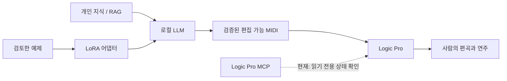

# DeepChord

[English](README.md) · **한국어**

**Sovereign Music Lab의 프로젝트입니다.**

**로컬의 지식 → 편집 가능한 음악 → 사람의 연주.**

DeepChord는 로컬 모델로 피아노 음표를 생성하고, 검증한 뒤 편집 가능한 MIDI로 내보내는 작곡 도구입니다. Logic Pro로 결과를 전달하고, 사람의 피드백을 기록하며, 개인 MLX LoRA 어댑터를 학습하고 재사용할 수 있습니다.

## RAG · LoRA → 로컬 LLM → Logic Pro MCP → 작곡



**현재 구현 범위:** 로컬 작곡, 선택적 개인 RAG, 개인 MLX LoRA 학습·재사용, MIDI 검증, 전체 파일 단위 Logic 전달입니다. MCP 클라이언트는 상태·세션·리전 정보를 읽습니다. MCP로 작곡과 편집을 완전히 자동 수행하는 흐름은 향후 확장 대상입니다. RAG 검색과 LoRA 학습은 별개이며, 개인 자료와 모델 가중치는 저장소에 포함하지 않습니다.

## 설치하고 실행하기 — Python 3.11 이상

Git과 Python을 준비하고 다음 명령을 실행하세요. 아래 예시는 macOS의 zsh/bash 기준입니다.

```sh
git clone https://github.com/Sovereign-Music-Lab/DeepChord.git
cd DeepChord
python3 -m venv .venv
source .venv/bin/activate
python -m pip install .
deepchord doctor
deepchord demo --out "$HOME/Music/sovereign-demo"
```

설치 후 demo에는 모델·책·계정·네트워크가 필요하지 않습니다. 생성되는 2마디 예제는 **설치 확인용 고정 패턴**이며 AI 작곡 결과가 아닙니다. 실행할 때마다 새 출력 폴더를 사용하세요. `doctor`에 Ollama 미연결 메시지가 표시되어도 demo는 실행할 수 있습니다.

AI 작곡에는 [Ollama](https://ollama.com/)를 별도로 설치·실행하고, 컴퓨터 사양에 맞는 로컬 모델을 준비하세요.

```sh
ollama list
deepchord compose '따뜻한 C장조 재즈 피아노곡, 마지막은 Cmaj7' --bars 4 --model YOUR_INSTALLED_LOCAL_MODEL
```

`YOUR_INSTALLED_LOCAL_MODEL`을 설치된 모델 태그로 바꾸세요. 개발 환경에서 사용한 태그는 `gemma4:12b-mlx`이며, 이 패키지에 포함되거나 자동으로 다운로드되지 않습니다. 클라우드 태그는 거부하며, Ollama 요청은 환경 프록시를 우회해 localhost로만 보냅니다. 생성 범위는 1–16마디이며, 모델 출력 수정 시도는 1회로 제한됩니다. 검증에 실패한 결과는 공개하지 않고 로컬에서 확인할 수 있도록 보관합니다.

기존 `sovereign-music` 명령도 호환용 별칭으로 사용할 수 있습니다. 기본 결과 위치는 `~/.local/share/sovereign-music/music/`입니다. `SOVEREIGN_MUSIC_HOME`으로 개인 작업 폴더를 변경할 수 있습니다. 소스 저장소에는 터미널 실행 도우미 `Start.command`도 있습니다.

## Logic 자동 연결 — macOS

```sh
deepchord logic open "$HOME/Music/sovereign-demo"
# 작곡 후 바로 Logic으로 전달:
deepchord compose '조용한 4마디 피아노 스케치' --bars 4 --model YOUR_INSTALLED_LOCAL_MODEL --logic
```

Logic Pro가 설치되어 있어야 합니다. 명령은 새 전체 MIDI 파일을 만들고 macOS Launch Services를 통해 Logic으로 엽니다. 음표, 템포, 편집 가능한 CC64 페달 이벤트를 MIDI에 보존하며, 사용자가 수정한 기존 MIDI를 덮어쓰지 않습니다. 다른 프로젝트를 열기 전에 현재 작업을 저장하세요. Logic의 프로젝트·템포 대화상자를 확인하고, 설치된 사운드 라이브러리에 맞게 악기를 선택해야 할 수 있습니다.

`logic-handoff.json`은 **열기 요청 수락**과 **실제 가져오기·소리 재생 확인**을 구분합니다. 앱을 열었다는 이유로 소리를 검증했다고 보고하지 않습니다. 이 버전은 GUI 대화상자, 악기 선택, 프로젝트 저장, 자동 청취를 자동화하지 않습니다.

선택적 [Logic Pro MCP](https://github.com/MongLong0214/logic-pro-mcp) 상태 확인:

```sh
deepchord logic inspect --mcp-config /path/to/private/logic.toml
deepchord logic open /path/to/run --mcp-config /path/to/private/logic.toml
```

개인 TOML 파일의 `[logic]`에 `command`, 선택적 `args`, `[logic.env]`를 지정합니다. 기존 `[mcp_servers.logic-pro]` 설정도 지원합니다. [Logic 연결 안내](docs/logic.ko.md)를 참고하세요. DeepChord 사용에는 Codex 계정이 필요하지 않습니다. 전체 MIDI 파일을 열 때 MCP는 선택 사항이며, 모델이 임의로 선택한 도구를 실행하지 않습니다.

## 개인 RAG (선택)

책·PDF·OCR·RAG 카드·발췌문·색인은 포함하지 않습니다. 개인 RAG를 설정하지 않으면 책의 근거를 사용하지 않았다고 명시적으로 기록합니다. 호환되는 개인 로컬 라이브러리를 연결하려면:

```sh
export MUSIC_RAG_ROOT=/path/to/your/private/musicRAG
deepchord rag '투파이브 루트리스 보이싱'
```

어댑터는 현재 Python으로 `scripts/rag.py query TEXT --top 3 --kind concept --context`를 실행합니다. 다른 라이브러리도 이 로컬 인터페이스를 구현할 수 있습니다. 검색 근거는 로컬 모델에만 전달하고 개인 실행 폴더에 저장합니다. RAG 검색 자체는 모델 가중치를 학습하지 않습니다.

## LoRA 학습과 재사용 — Apple Silicon

```sh
python -m pip install '.[train]'
deepchord train prepare /path/to/reviewed.jsonl --out /path/to/private/dataset
deepchord train run --model /path/to/local-mlx-model --data /path/to/private/dataset --out /path/to/private/adapter --iters 100
deepchord train generate 'Return a Cmaj7 piano sketch as JSON.' --model /path/to/local-mlx-model --adapter /path/to/private/adapter
deepchord compose '4마디 피아노 스케치' --bars 4 --model /path/to/local-mlx-model --adapter /path/to/private/adapter
```

학습에는 호환되는 **로컬 MLX 모델 폴더**가 필요합니다. Ollama 태그를 입력하면 안 됩니다. 자동 변환이나 다운로드는 하지 않습니다. 검증한 선택 의존성은 `mlx-lm[train]==0.32.2`입니다. 학습과 어댑터 추론에는 Hugging Face 오프라인 모드를 적용하며 원격 코드 실행을 허용하지 않습니다. 어댑터는 로컬에 보관하며 이 저장소에 합치거나 업로드하지 않습니다.

[학습 안내](docs/training.ko.md)는 검토 기록 형식, 그룹 단위 학습·검증·테스트 분리, 소형 모델 실행 검사와 한계를 설명합니다. 3회 반복 학습 검사는 실행 경로만 확인하며, 음악적으로 유용한 학습이나 Gemma 어댑터 호환성의 근거가 아닙니다.

## 사람의 피드백

```sh
deepchord validate /path/to/run/composition.json
deepchord feedback /path/to/run --rating 4 --note '마지막 프레이즈 전에 숨 쉴 공간을 더 주세요'
```

피드백은 작곡 데이터의 해시와 함께 저장하며, 자동으로 재학습하지 않습니다. JSON과 Logic 내부 수정도 자동 동기화되지 않습니다.

## 비공개 자료와 배포

공개 저장소는 **코드·테스트·문서와 검토된 웹 브랜드 이미지**를 담습니다. 원본 PDF, RAG 데이터, 학습 데이터, 모델 가중치, LoRA 어댑터, 생성된 MIDI·오디오, Logic 프로젝트, 개인 설정과 실행 로그는 제외합니다. 기본적으로 새 최상위 경로의 Git 추가를 막고, 추적 파일 검사와 CI로 다시 확인합니다. 실행 자료는 외부 기본 작업 폴더 또는 Git에서 제외된 `.private/`에 보관하세요.

```sh
python -m unittest discover -s tests -v
python scripts/check_public.py
python scripts/check_site.py
python -m pip install build
python -m build
```

소스 코드는 [Apache License 2.0](LICENSE)을 따릅니다. 별도 교재, 모델, 샘플 라이브러리, 학습 자료의 권리는 해당 권리자와 별도 조건을 따릅니다. 패키지는 원격 저장소나 릴리스를 자동 생성하지 않습니다.

## 확인한 범위

- MIDI 바이트 왕복, 음표 범위·타이밍·페달 종료, 지원 코드 이름, 클라우드 거부, 데이터 분리·비공개 처리, 파일 전달 테스트.
- 실제 로컬 Ollama를 사용한 개발 중 작곡 실행.
- 소형 모델의 MLX QLoRA 학습, 별도 테스트 손실 계산과 어댑터 재로딩.
- 76 BPM, 두 개 Studio Grand 트랙의 MIDI 예제를 Logic Pro 13.0에서 열고 GUI로 로컬 저장. 이 확인은 Launch Services의 모의 단위 테스트와 별개입니다.
- 전반적 음악 품질, 자동 악기 배정, 완전 무인 대화상자 처리, 전문 청취 평가는 검증하지 않았습니다. 특정 GPT 수준의 작곡 능력을 주장하지 않습니다.

## 프로젝트 소개와 크레딧

[Sovereign Music Lab 한국어 사이트](https://sovereign-music-lab.github.io/)에서 철학, 크레딧과 창작 흐름을 볼 수 있습니다. 사이트 소스는 `site/`에 있습니다. [배포 안내](docs/landing-page.ko.md)는 이 하위 폴더만 GitHub Pages로 공개하는 방법을 설명합니다.

- [Hee-sung Kang · 강희성](https://ikoffices.com/)
- [Do-won Lee · 이도원](https://music.bugs.co.kr/artist/80353758?wl_ref=list_ar_02_search)
- [Sungmo Park · 박성모](mailto:vividsaebom@gmail.com)
