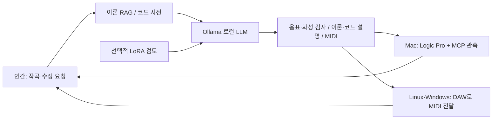

# DeepChord

**Authors / Project credits:** [Hee-sung Kang · 강희성](https://ikoffices.com/) · [Do-won Lee · 이도원](https://music.bugs.co.kr/artist/80353758?wl_ref=list_ar_02_search) · [Sungmo Park · 박성모](mailto:vividsaebom@gmail.com)

[Organization](https://github.com/Sovereign-Music-Lab) · [Website](https://sovereign-music-lab.github.io/) · [DeepChord](https://github.com/Sovereign-Music-Lab/DeepChord) · [Sovereign DAW](https://github.com/Sovereign-Music-Lab/sovaroll-DAW) · [Sovereign Flow](https://github.com/Sovereign-Music-Lab/SovaFlow)

## 초록
[English](README.md) · **한국어**

**Sovereign Music Lab · 로컬의 지식 → 편집 가능한 음악 → 사람의 다음 요청.**

Linux·Windows·macOS에서 사용하는 로컬 피아노 작곡 도구입니다. 공개 이론 RAG와 코드 사전, Ollama 로컬 LLM, 선택적 LoRA, MIDI·설명과 지속 세션을 연결합니다. Mac에서는 Logic Pro와 MCP 상태 관측을 함께 사용할 수 있습니다.

## 목차

- [인간이 계속 주문하는 작곡 루프](#인간이-계속-주문하는-작곡-루프)
- [공개 기초 자산](#공개-기초-자산)
- [설치 — Python 3.11 이상](#설치--python-311-이상)
- [작곡하고 계속 수정](#작곡하고-계속-수정)
- [Logic Pro + MCP — Mac](#logic-pro--mcp--mac)
- [LoRA와 이론 검토](#lora와-이론-검토)
- [개인 RAG (선택)](#개인-rag-선택)
- [피드백·검사·공개 범위](#피드백검사공개-범위)
- [프로젝트와 크레딧](#프로젝트와-크레딧)
- [개발 인계](#개발-인계)

## 인간이 계속 주문하는 작곡 루프



매번 새 주문을 받아 직전 성공 버전을 수정하고, `/quit` 이후에도 같은 이름으로 이어갑니다. 실패는 기록하며 이전 버전을 보존합니다. 현재 생성 범위는 1–16마디 피아노 스케치입니다. 완성곡의 모든 편성·음색·믹스나 Logic 편집을 무인 자동화했다고 주장하지 않습니다.

## 공개 기초 자산

교재와 독립적으로 작성한 **24개 이론 카드 + 32개 간격 공식 × 12근음 = 384개 코드 항목**을 포함합니다. 검색·코드 계산에는 PDF·계정·네트워크가 필요하지 않습니다. 원본 책, OCR, 목차·페이지 위치, 악보와 교재 예제는 포함하지 않습니다.

```sh
deepchord rag '장조 투파이브와 루트리스 보이싱'
deepchord chord 'Cdim7'
deepchord foundation --out /path/to/new/foundation
```

내보내기는 RAG 문서 408개와 한·영 LoRA 예제 816개, 출처·해시 명세를 재현합니다. 소스 TOML·수식과 공개 자료에서의 재생성 방법을 배포합니다. 새 문장·코드는 Apache-2.0이며 음악 이론의 사실 자체에 독점권을 주장하지 않습니다. [기초 자산·권리 구분·반복 루프·운영체제 안내](docs/foundation.ko.md)를 참고하세요.

## 설치 — Python 3.11 이상

Linux/macOS:

```sh
git clone https://github.com/Sovereign-Music-Lab/DeepChord.git
cd DeepChord
python3 -m venv .venv
source .venv/bin/activate
python -m pip install .
deepchord doctor
deepchord demo --out "$HOME/Music/deepchord-demo"
```

Windows PowerShell:

```powershell
git clone https://github.com/Sovereign-Music-Lab/DeepChord.git
cd DeepChord
py -3 -m venv .venv
.venv\Scripts\python.exe -m pip install .
.venv\Scripts\deepchord.exe doctor
.venv\Scripts\deepchord.exe session --name my-song --model YOUR_INSTALLED_LOCAL_MODEL
```

`demo`는 고정 패턴의 설치 검사이며 AI 작곡이 아닙니다. [Ollama](https://ollama.com/)는 별도 설치·실행하고 `ollama list`에서 로컬 모델을 확인하세요. 개발 Mac의 기본 태그는 `gemma4:12b-mlx`입니다. 다른 운영체제에서 이 태그의 가용성을 보장하지 않으며 `--model`로 설치 모델을 지정합니다. 클라우드 모델은 거부하며 모델을 자동 다운로드하지 않습니다.

## 작곡하고 계속 수정

```sh
deepchord session --name my-song --model gemma4:12b-mlx --bars 4
# 입력 예: 따뜻한 C장조 피아노 리프를 만들어줘
# 다음 입력 예: 선율은 유지하고 반주를 더 비워줘
# /explain /status /new /open /quit
```

비대화형으로는 `--request '첫 주문' --request '수정 주문'`을 사용합니다. 한 번만 생성하려면:

```sh
deepchord compose '따뜻한 C장조 피아노 스케치, 마지막 Cmaj7' --bars 4 --model gemma4:12b-mlx
# 특정 이전 결과를 수정:
deepchord compose '반주를 더 비워줘' --bars 4 --previous-run /path/to/run --model gemma4:12b-mlx
```

매번 `composition.json`, 편집 가능한 `composition.mid`, `validation.json`, `EXPLANATION.md`, `explanation.json`을 보존합니다. 설명에는 마디별 코드와 구성음, 코드명에서 검출한 ii–V–I, 검색한 이론 후보를 구분합니다. 검색한 내용을 모두 실제로 적용했다고 표시하지 않습니다. `deepchord explain RUN`으로 JSON 수정 후 다시 계산합니다.

실행 자료는 기본 `~/.local/share/sovereign-music/`에 저장하며 `SOVEREIGN_MUSIC_HOME`으로 바꿀 수 있습니다. 같은 세션 이름으로 재시작하면 이어집니다. 모델 출력이 음표·코드 검사를 통과하지 못하면 한 번 수정 요청 후 실패를 기록하고 다음 주문을 받습니다. `Start.command`도 지속 세션을 엽니다.

## Logic Pro + MCP — Mac

```sh
deepchord session --name my-song --model gemma4:12b-mlx --logic \
  --mcp-config /path/to/private/logic.toml
deepchord logic open /path/to/run --mcp-config /path/to/private/logic.toml
```

전체 MIDI의 템포·음표·CC64를 유지해 Logic에 열기를 요청하고, 선택적 MCP로 세션·리전 상태를 읽습니다. 사용자가 현재 작업을 저장하고 대화상자·악기·재생·프로젝트 저장을 확인해야 합니다. CLI의 MCP는 현재 읽기 전용이며 자동 악기 선택·플러그인 믹스·프로젝트 저장을 완료하지 않습니다. `logic-handoff.json`은 요청 수락과 실제 가져오기·소리를 구분합니다. [Logic 안내](docs/logic.ko.md).

Logic은 Mac에서 실행합니다. Linux·Windows에서는 `deepchord export RUN --out /path/to/new.mid`로 DAW에 전달하거나 Mac으로 파일을 옮깁니다. MIDI 수정은 이전에 렌더한 오디오나 Logic 내부 편집과 자동 동기화되지 않습니다.

## LoRA와 이론 검토

```sh
deepchord foundation --out /path/to/new/foundation
deepchord train prepare /path/to/new/foundation/reviewed.jsonl --out /path/to/new/splits
python -m pip install '.[train]'
deepchord train run --backend mlx --model /path/to/local-mlx-model \
  --data /path/to/new/splits --out /path/to/new/adapter --iters 100
# Ollama 작곡 + 별도 로컬 LoRA 이론 검토:
deepchord session --name my-song --model gemma4:12b-mlx \
  --theory-model /path/to/local-mlx-model --theory-adapter /path/to/adapter
```

이론 검토 응답은 미검증 제안으로 기록하고 수식·음표 검사로 대조합니다. MLX 어댑터를 Ollama에 자동 주입하지 않습니다. `--adapter`는 작곡 자체를 직접 로컬 어댑터 추론으로 실행하는 별도 선택입니다. Linux·Windows·macOS의 호환 비양자화 Hugging Face 모델에는 `.[train-portable]`와 `--backend transformers`를 사용할 수 있습니다. 가중치 다운로드·변환은 자동화하지 않습니다. [학습 안내](docs/training.ko.md), [기초 자산과 백엔드 범위](docs/foundation.ko.md).

## 개인 RAG (선택)

공개 기초 RAG는 기본 제공됩니다. 사용 권한이 있는 개인 교재를 추가하려면 외부 호환 제공자를 연결하세요.

```sh
export MUSIC_RAG_ROOT=/path/to/your/private/musicRAG
deepchord rag '피아노 코드 전위'
```

외부 `scripts/rag.py query TEXT --top 3 --kind concept --context`의 결과를 공개 근거와 함께 로컬 모델에 전달합니다. 개인 자료와 근거는 공개 자산·학습 예제에 자동 합치지 않습니다. [전체 방법과 검증](docs/methodology.ko.md).

## 피드백·검사·공개 범위

```sh
deepchord validate /path/to/run/composition.json
deepchord feedback /path/to/run --rating 4 --note '마지막 구절에 더 여유를 주세요'
python -m unittest discover -s tests -v
python scripts/check_public.py
python scripts/check_site.py
```

피드백은 자동 재학습을 유발하지 않습니다. 공개 저장소는 코드·문서·테스트·브랜드 이미지와 독립 작성한 기초 TOML·공식·생성 방법을 담습니다. 교재·교재 기반 RAG, 모델 가중치·어댑터·개인 데이터·생성 음악·설정·실행 로그는 제외합니다. 플랫폼 CI는 Linux·Windows·macOS에서 기본 패키지를 검사하며 실제 모델·DAW·GPU 학습 검사는 별도로 기록합니다.

[실행 확인과 제한](docs/verification.ko.md)에서 실제 학습·세션 검증 범위를 확인하세요. 손실이나 테스트 통과만으로 음악적 품질을 보장하지 않습니다.

## 프로젝트와 크레딧

[Sovereign Music Lab 한국어 사이트](https://sovereign-music-lab.github.io/) · [사이트 배포](docs/landing-page.ko.md) · [Apache License 2.0](LICENSE)

- [Hee-sung Kang · 강희성](https://ikoffices.com/)
- [Do-won Lee · 이도원](https://music.bugs.co.kr/artist/80353758?wl_ref=list_ar_02_search)
- [Sungmo Park · 박성모](mailto:vividsaebom@gmail.com)

## 개발 인계

[CONTEXT.md](CONTEXT.md) · [Model operations / 모델 운영](docs/MODEL_OPERATIONS.ko.md) · [Reusable skill / 재사용 스킬](skills/model-tier-handoff/SKILL.md)
