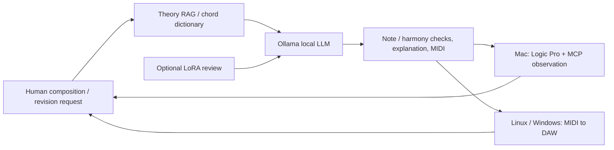

# DeepChord

**English** · [한국어](README.ko.md)

**Sovereign Music Lab · Local knowledge → editable music → the human's next request.**

A local piano composition toolkit for Linux, Windows, and macOS. It connects public theory RAG and a chord dictionary, an Ollama local LLM, optional LoRA, MIDI explanations, and persistent revision sessions. On a Mac, add Logic Pro handoff and MCP observation.

## A continuing human composition loop



Each new request revises the last successful version. Resume by session name after `/quit`; failures preserve earlier versions. Generation currently covers 1–16-bar piano sketches, not unattended finished orchestration, sound design, mixing, or complete Logic editing.

## Public foundations

Includes **24 original theory cards + 32 interval formulas × 12 roots = 384 chord entries**. Retrieval and calculation require no PDF, account, or network. Original books, OCR, index/page locators, scores, and textbook examples are excluded.

```sh
deepchord rag 'major ii-V-I and rootless voicings'
deepchord chord 'Cdim7'
deepchord foundation --out /path/to/new/foundation
```

Exports reproduce 408 RAG records, 816 bilingual LoRA examples, and a provenance/hash manifest. The repository ships their TOML/formula sources and reproducible generation code. New wording and code use Apache-2.0; the project claims no monopoly on theoretical facts. See [foundations, rights boundaries, sessions, and platforms](docs/foundation.md).

## Install — Python 3.11+

Linux/macOS:

```sh
git clone https://github.com/Sovereign-Music-Lab/DeepChord.git
cd DeepChord
python3 -m venv .venv
source .venv/bin/activate
python -m pip install .
deepchord doctor
deepchord demo --out "$HOME/Music/deepchord-demo"
```

Windows PowerShell:

```powershell
git clone https://github.com/Sovereign-Music-Lab/DeepChord.git
cd DeepChord
py -3 -m venv .venv
.venv\Scripts\python.exe -m pip install .
.venv\Scripts\deepchord.exe doctor
.venv\Scripts\deepchord.exe session --name my-song --model YOUR_INSTALLED_LOCAL_MODEL
```

`demo` is a fixed installation fixture, not AI composition. Install/run [Ollama](https://ollama.com/) separately and inspect `ollama list`. The development Mac's default tag is `gemma4:12b-mlx`; that tag is not guaranteed on other operating systems. Supply an installed local model with `--model`. Cloud models are refused and models are not automatically downloaded.

## Compose and keep revising

```sh
deepchord session --name my-song --model gemma4:12b-mlx --bars 4
# First request: Make a warm C-major piano riff.
# Next request: Keep the melody and leave more space in the accompaniment.
# /explain /status /new /open /quit
```

For a non-interactive list, repeat `--request 'first request' --request 'revision'`. For one composition:

```sh
deepchord compose 'A warm C-major piano sketch, ending on Cmaj7' --bars 4 --model gemma4:12b-mlx
# Revise a specific earlier run:
deepchord compose 'Leave more space in the accompaniment' --bars 4 --previous-run /path/to/run --model gemma4:12b-mlx
```

Every result preserves `composition.json`, editable `composition.mid`, `validation.json`, `EXPLANATION.md`, and `explanation.json`. Explanations distinguish chords and tones per bar, ii–V–I patterns detected in chord labels, and retrieved theory candidates. Retrieval is not proof of application. Recalculate after JSON edits with `deepchord explain RUN`.

Runs default to `~/.local/share/sovereign-music/`; override with `SOVEREIGN_MUSIC_HOME`. Reusing a session name resumes it. Invalid model output gets one repair attempt, then records failure while allowing the next request. `Start.command` also opens a persistent session.

## Logic Pro + MCP — Mac

```sh
deepchord session --name my-song --model gemma4:12b-mlx --logic \
  --mcp-config /path/to/private/logic.toml
deepchord logic open /path/to/run --mcp-config /path/to/private/logic.toml
```

The full MIDI preserves tempo, notes, and CC64 when requesting Logic to open it. Optional MCP reads session and region state. Save current work and resolve dialogs, instruments, playback, and project saving in Logic. The CLI's MCP integration is currently read-only; it does not complete automatic instrument selection, plug-in mixing, or project saving. `logic-handoff.json` separates request acceptance from verified import or audio. See [Logic integration](docs/logic.md).

Logic runs on a Mac. On Linux/Windows, use `deepchord export RUN --out /path/to/new.mid` for another DAW, or transfer the file to a Mac. MIDI edits do not automatically update existing audio renders or edits made inside Logic.

## LoRA and theory review

```sh
deepchord foundation --out /path/to/new/foundation
deepchord train prepare /path/to/new/foundation/reviewed.jsonl --out /path/to/new/splits
python -m pip install '.[train]'
deepchord train run --backend mlx --model /path/to/local-mlx-model \
  --data /path/to/new/splits --out /path/to/new/adapter --iters 100
# Ollama composer plus a separate local LoRA theory reviewer:
deepchord session --name my-song --model gemma4:12b-mlx \
  --theory-model /path/to/local-mlx-model --theory-adapter /path/to/adapter
```

Reviewer responses remain unverified proposals checked against formulas and events. MLX adapters are not automatically injected into Ollama. `--adapter` separately selects direct local adapter inference for composition itself. For compatible unquantized Hugging Face models on Linux, Windows, or macOS, use `.[train-portable]` and `--backend transformers`. No automatic weight download/conversion. See [training](docs/training.md) and [foundation/backend scope](docs/foundation.md).

## Private RAG (optional)

Public foundation RAG is built in. Connect a compatible external provider for private material you have rights to use:

```sh
export MUSIC_RAG_ROOT=/path/to/your/private/musicRAG
deepchord rag 'piano chord inversions'
```

External `scripts/rag.py query TEXT --top 3 --kind concept --context` output supplements public evidence for the local model. Private evidence is not automatically merged into public foundations or training exports. See [method and verification](docs/methodology.md).

## Feedback, checks, and publication boundary

```sh
deepchord validate /path/to/run/composition.json
deepchord feedback /path/to/run --rating 4 --note 'Leave more space before the final phrase'
python -m unittest discover -s tests -v
python scripts/check_public.py
python scripts/check_site.py
```

Feedback does not automatically retrain weights. Public files include code, docs, tests, brand assets, and independently authored foundation TOML/formulas/generation code. Books and book-derived RAG, model weights/adapters, private datasets, generated music, settings, and logs remain private. Platform CI checks the base package on Linux, Windows, and macOS; actual model, DAW, and GPU training checks are separate.

See [execution evidence and limitations](docs/verification.md). Loss and passing tests do not establish musical quality.

## Project and credits

[Sovereign Music Lab English site](https://sovereign-music-lab.github.io/en/) · [Publishing notes](docs/landing-page.md) · [Apache License 2.0](LICENSE)

- [Hee-sung Kang](https://ikoffices.com/)
- [Do-won Lee](https://music.bugs.co.kr/artist/80353758?wl_ref=list_ar_02_search)
- [Sungmo Park](mailto:vividsaebom@gmail.com)
