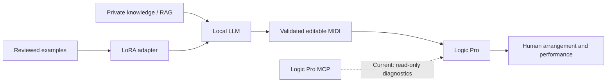

# DeepChord

**A Sovereign Music Lab project.**

**Local knowledge → editable music → human performance.**

DeepChord is a local-first piano composition toolkit: generate symbolic music with a local model, validate notes, export editable MIDI, hand it to Logic Pro, record human feedback, and train private MLX LoRA adapters.

## RAG · LoRA → Local LLM → Logic Pro MCP → Composition

DeepChord는 개인의 음악 지식과 로컬 모델을 연결하고, Logic Pro에서 수정하고 연주할 수 있는 음악을 만드는 프로젝트입니다.



**Current implementation:** local composition, optional private RAG, private MLX LoRA training/reuse, MIDI validation, and full-file handoff to Logic Pro. The MCP client currently reads health/session/region state; a fully autonomous MCP composition/editing loop is a future extension. RAG retrieval and LoRA training are separate paths, and neither private data nor weights ship with this repository.

## Install and try (Python 3.11+)

Clone the repository and install locally:

```sh
git clone https://github.com/Sovereign-Music-Lab/DeepChord.git
cd DeepChord
python3 -m venv .venv
source .venv/bin/activate
python -m pip install .
deepchord doctor
deepchord demo --out "$HOME/Music/sovereign-demo"
```

The demo needs no model, book, account or network after installation. It produces an original two-bar **deterministic installation fixture**, not an AI composition. Choose a new output directory for each run.

For AI composition, install [Ollama](https://ollama.com/) separately and obtain a locally runnable model suitable for your hardware. Then:

```sh
ollama list
deepchord compose '따뜻한 C장조 재즈 피아노곡, 마지막은 Cmaj7' --bars 4 --model YOUR_INSTALLED_LOCAL_MODEL
```

Replace `YOUR_INSTALLED_LOCAL_MODEL` with an installed tag. The local author's tested tag is `gemma4:12b-mlx`; it is not downloaded or included by this package. Cloud tags are rejected. Ollama requests go only to localhost, bypassing environment proxies. Generation is bounded to 1–16 bars and one repair attempt. Validation may reject the model output; failed attempts remain available privately for inspection.

The legacy `sovereign-music` command remains an alias for compatibility.

Runs default to `~/.local/share/sovereign-music/music/`. Set `SOVEREIGN_MUSIC_HOME` to use another private working directory. A source checkout also provides `Start.command` for a terminal launcher.

## Automatic Logic handoff (macOS)

```sh
deepchord logic open "$HOME/Music/sovereign-demo"
# Or compose and open in one command:
deepchord compose 'A quiet four-bar piano sketch' --bars 4 --model YOUR_INSTALLED_LOCAL_MODEL --logic
```

Logic Pro must be installed. The command creates a new full MIDI handoff file and asks macOS Launch Services to open it in Logic. Track notes, tempo and editable CC64 pedal events are preserved in the MIDI. Existing user-edited MIDI files are not overwritten. Save your work before opening a different project; Logic may show its native project/tempo dialogs. Instrument availability depends on your Logic library.

`logic-handoff.json` explicitly separates **open request accepted** from **verified import/audio**. It never reports audible playback just because the app opened. GUI dialogs, native patch selection, saving and automatic listening are not automated in this release.

Optional [Logic Pro MCP](https://github.com/MongLong0214/logic-pro-mcp) diagnostics:

```sh
deepchord logic inspect --mcp-config /path/to/private/logic.toml
deepchord logic open /path/to/run --mcp-config /path/to/private/logic.toml
```

The private TOML may contain `[logic]` with `command`, optional `args`, and `[logic.env]`; existing `[mcp_servers.logic-pro]` config is also accepted. See [Logic connection](docs/logic.md). No Codex account is required for the toolkit. MCP is optional for full-file handoff and does not execute arbitrary tool choices from the model.

## Private RAG (optional)

No book, PDF, OCR, RAG card, excerpt or index is bundled. Without a private RAG configuration, the program explicitly records that no book evidence was used. To connect an existing compatible local library:

```sh
export MUSIC_RAG_ROOT=/path/to/your/private/musicRAG
deepchord rag '투파이브 루트리스 보이싱'
```

The adapter invokes `scripts/rag.py query TEXT --top 3 --kind concept --context` with the current Python interpreter. Other libraries can implement this local interface. Retrieved evidence is sent only to the local model and stored in the private run directory. RAG is retrieval, not weight training.

## LoRA training and reuse (Apple Silicon)

```sh
python -m pip install '.[train]'
deepchord train prepare /path/to/reviewed.jsonl --out /path/to/private/dataset
deepchord train run --model /path/to/local-mlx-model --data /path/to/private/dataset --out /path/to/private/adapter --iters 100
deepchord train generate 'Return a Cmaj7 piano sketch as JSON.' --model /path/to/local-mlx-model --adapter /path/to/private/adapter
deepchord compose 'A four-bar piano sketch' --bars 4 --model /path/to/local-mlx-model --adapter /path/to/private/adapter
```

Training requires a compatible local MLX model directory, **not an Ollama model tag**. No automatic conversion or downloads occur. `mlx-lm[train]==0.32.2` is the tested optional dependency. Training and adapter inference run with Hugging Face offline mode and no remote-code opt-in. LoRA adapters remain local; no weights are fused into or uploaded with this repository.

[Training guide](docs/training.md) describes the reviewed record format, grouped train/validation/test splits, a small pipeline smoke test, and limitations. A three-step smoke run verifies mechanics only; it is not evidence of useful musical fine-tuning, nor of Gemma adapter compatibility.

## Human feedback

```sh
deepchord validate /path/to/run/composition.json
deepchord feedback /path/to/run --rating 4 --note 'Leave more breathing room before the last phrase'
```

Feedback is stored with the composition hash. It does not silently retrain the model. JSON and edits made inside Logic do not automatically synchronize.

## Privacy and distribution

This repository contains **code, tests and documentation only**. Original PDFs, RAG data, datasets, model weights, LoRA adapters, generated MIDI/audio, Logic projects, personal configuration and runtime logs are excluded. The root ignore policy denies new top-level paths by default; the tracked-file scanner and CI provide an additional check. Keep runtime data in the external default directory or an ignored `.private/` folder.

```sh
python -m unittest discover -s tests -v
python scripts/check_public.py
python -m pip install build
python -m build
```

The source code is MIT licensed; this does not grant rights to any separate book, model, sample library or dataset. No remote repository or release is created by the package.

## Current verification scope

- MIDI byte round-trip tests, note ranges/timing, pedal releases, supported chord-label checks, cloud rejection, dataset split/privacy and handoff tests.
- Real local Ollama composition exercised during development.
- Real MLX QLoRA smoke training, held-out loss evaluation and adapter reload exercised on a small model.
- A two-track MIDI fixture opened in Logic Pro 13.0 with 76 BPM and two Studio Grand tracks, then saved locally via GUI. This GUI test is distinct from the Launch Services command's mocked unit test.
- General musical quality, automatic instrument assignment, fully unattended dialogs and professional listening evaluation are **not** validated. No “GPT-level composition” claim is made.

## Project introduction

Visit [Sovereign Music Lab](https://sovereign-music-lab.github.io/) for the project philosophy, credits and creative workflow. The static introduction lives in `site/`; [publishing notes](docs/landing-page.md) explain how only that subtree reaches GitHub Pages.
