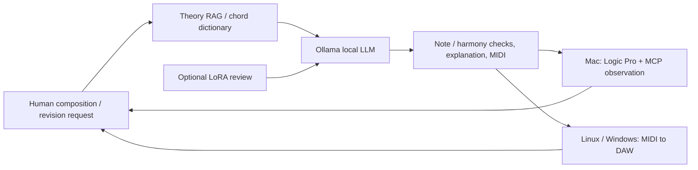

# DeepChord

**Authors / Project credits:** [Hee-sung Kang · 강희성](https://ikoffices.com/) · [Do-won Lee · 이도원](https://music.bugs.co.kr/artist/80353758?wl_ref=list_ar_02_search) · [Sungmo Park · 박성모](mailto:vividsaebom@gmail.com)

[Organization](https://github.com/Sovereign-Music-Lab) · [Website](https://sovereign-music-lab.github.io/) · [DeepChord](https://github.com/Sovereign-Music-Lab/DeepChord) · [Sovereign DAW](https://github.com/Sovereign-Music-Lab/sovaroll-DAW) · [Sovereign Flow](https://github.com/Sovereign-Music-Lab/SovaFlow)

## Abstract
**English** · [한국어](README.ko.md)

**Sovereign Music Lab · Local knowledge → editable music → the human's next request.**

A local piano composition toolkit for Linux, Windows, and macOS. It connects public theory RAG and a chord dictionary, an Ollama local LLM, optional LoRA, MIDI explanations, and persistent revision sessions. On a Mac, add Logic Pro handoff and MCP observation.

## Contents

- [A continuing human composition loop](#a-continuing-human-composition-loop)
- [Public foundations](#public-foundations)
- [Install — Python 3.11+](#install--python-311)
- [Compose and keep revising](#compose-and-keep-revising)
- [Logic Pro + MCP — Mac](#logic-pro--mcp--mac)
- [LoRA and theory review](#lora-and-theory-review)
- [Private RAG (optional)](#private-rag-optional)
- [Feedback, checks, and publication boundary](#feedback-checks-and-publication-boundary)
- [Project and credits](#project-and-credits)
- [Development handoff](#development-handoff)

## A continuing human composition loop



Each new request revises the last successful version. Resume by session name after `/quit`; failures preserve earlier versions. Generation currently covers 1–16-bar piano sketches, not unattended finished orchestration, sound design, mixing, or complete Logic editing.

## Public foundations

Includes **24 original theory cards + 32 interval formulas × 12 roots = 384 chord entries**. Retrieval and calculation require no PDF, account, or network. Original books, OCR, index/page locators, scores, and textbook examples are excluded.

```sh
deepchord rag 'major ii-V-I and rootless voicings'
deepchord chord 'Cdim7'
deepchord foundation --out /path/to/new/foundation
```

Exports reproduce 408 RAG records, 816 bilingual LoRA examples, and a provenance/hash manifest. The repository ships their TOML/formula sources and reproducible generation code. New wording and code use Apache-2.0; the project claims no monopoly on theoretical facts. See [foundations, rights boundaries, sessions, and platforms](docs/foundation.md).

## Install — Python 3.11+

Linux/macOS:

```sh
git clone https://github.com/Sovereign-Music-Lab/DeepChord.git
cd DeepChord
python3 -m venv .venv
source .venv/bin/activate
python -m pip install .
deepchord doctor
deepchord demo --out "$HOME/Music/deepchord-demo"
```

Windows PowerShell:

```powershell
git clone https://github.com/Sovereign-Music-Lab/DeepChord.git
cd DeepChord
py -3 -m venv .venv
.venv\Scripts\python.exe -m pip install .
.venv\Scripts\deepchord.exe doctor
.venv\Scripts\deepchord.exe session --name my-song --model YOUR_INSTALLED_LOCAL_MODEL
```

`demo` creates a fixed example to check the installation; it is not an AI-composed piece.

For AI composition, install and run [Ollama](https://ollama.com/) and install a model separately. Type `ollama list` in the terminal to see installed models. If `gemma4:12b-mlx` is not listed, replace it in the examples with the name of an installed local model. Availability depends on your computer and operating system. DeepChord does not download models or switch to cloud models automatically.

## Compose and keep revising

Enter this command to start a conversation for a four-bar piece. You can replace `my-song` with another English name to identify your piece.

```sh
deepchord session --name my-song --model gemma4:12b-mlx --bars 4
```

When `composer>` appears, describe the music you want, such as “Make a warm C-major piano melody.” Once the result appears, you can continue with “Keep the melody and leave more space in the accompaniment.” Earlier versions are kept. Enter `/quit` to finish; start again with the same name to resume.

During a session, `/explain` shows the explanation, `/status` shows progress, `/new` starts a new piece, and `/open` requests that Logic open the latest result.

**First-time tip:** At `composer>`, enter a music request or a session command such as `/open`. Shell commands such as `ollama list` and `deepchord session ...` belong in the normal terminal; enter `/quit` first. `YOUR_INSTALLED_LOCAL_MODEL` is a placeholder, not a model name; check installed names with `ollama list`.

In the example, `--bars 4` means four bars. The current program generates a **1–16 bar piano sketch** per request, mainly melody and accompaniment. It does not automatically produce a complete arranged and mixed song. You can restart a session with `--bars 16` in the normal terminal, but longer generations may fail validation.

**Open and hear the result in Logic Pro (Mac):**

1. Save any Logic project you are working on first.
2. After a successful composition, enter `/open` at `composer>` to request opening the latest MIDI in Logic. MCP configuration is not required for this open request.
3. Review Logic's import or project dialogs; choose a software instrument for each track if needed and play it. An accepted open request does not establish that import or sound succeeded.
4. Use **File → Save** to save the Logic project. MIDI contains editable notes, not a finished audio recording.

If `/open` does not work, import `composition.mid` from the `Editable source:` folder printed after success. Review the target project and import options yourself.


For a non-interactive list, repeat `--request 'first request' --request 'revision'`. For one composition:

```sh
deepchord compose 'A warm C-major piano sketch, ending on Cmaj7' --bars 4 --model gemma4:12b-mlx
# Revise a specific earlier run:
deepchord compose 'Leave more space in the accompaniment' --bars 4 --previous-run /path/to/run --model gemma4:12b-mlx
```

Each result includes an editable MIDI file (`composition.mid`), an explanation (`EXPLANATION.md`), source data and validation results. Open the MIDI in Logic or another DAW to edit its notes. The explanation distinguishes the chords used from theory retrieved as reference.

Results are saved under `.local/share/sovereign-music/` in your home folder by default. If the output fails validation, DeepChord tries up to two repairs; if it still fails, earlier successful results remain available and you can make another request. On a Mac, `Start.command` also starts a session.

## Logic Pro + MCP — Mac

```sh
deepchord session --name my-song --model gemma4:12b-mlx --logic \
  --mcp-config /path/to/private/logic.toml
deepchord logic open /path/to/run --mcp-config /path/to/private/logic.toml
```

The `--logic` and `logic open` commands request a MIDI import and optionally observe its state; acceptance does not prove import or sound. The separate `--logic-project` route below also attempts to save a new project. Check instruments, playback, and mix yourself. See [Logic integration](docs/logic.md).

Logic runs on a Mac. On Linux/Windows, use `deepchord export RUN --out /path/to/new.mid` for another DAW, or transfer the file to a Mac. MIDI edits do not automatically update existing audio renders or edits made inside Logic.

### Save a new Logic project after a session

On a Mac, configure Logic Pro MCP, then save and close any current Logic project. Replace the example paths with your configuration and a new, non-existing `.logicx` destination.

```sh
deepchord session --name my-song --bars 4 --model gemma4:12b-mlx \
  --mcp-config /path/to/logic.toml --logic-project /path/to/my-song.logicx
```

After composing and revising, enter `/quit`. The last successful version is opened in Logic and saved as a new project; Logic is launched if necessary. Saving stops if the final request fails or the Logic project chooser cannot be confirmed. Note-by-note import, sound and musical quality are not automatically verified: check them in Logic. Earlier versions and editable MIDI are preserved. This creates a new project from a new MIDI version; it does not edit an existing Logic project in place.

### Change the tempo of an existing Logic project

First open the existing project in Logic, and replace the example paths with your project and a new destination. Currently this supports **explicit numeric tempo changes only**. Gemma interprets the request; DeepChord saves a new copy, changes the tempo, verifies it, and saves. The source file is not overwritten.

```sh
deepchord logic edit /path/to/song.logicx 'set tempo to 92 BPM' \
  --out /path/to/song-92.logicx --mcp-config /path/to/logic.toml
```

The workflow stops if the target is not open or a save or edit cannot be verified. Do not operate Logic during the workflow. A failed attempt can leave a copy or save dialog; inspect its state before trying again. General note, region, instrument, and mix editing is not yet supported.

### Change a note or move a region in an existing song

`logic edit-note` copies a saved song and lets Gemma change **the pitch of one existing note**. It preserves the source, compares the complete observed event list including pedal events, saves, and loads a separate copy of the saved bytes to check persistence. You do not need to run Codex.

```sh
deepchord logic edit-note "$HOME/Music/song.logicx" 'Raise the first note in Piano by a whole tone' \
  --out "$HOME/Music/song-edited.logicx" --model gemma4:12b-mlx \
  --mcp-config /path/to/logic.toml
```

Use `logic move-region` to move an entire region to another bar. Notes and pedal events move together, keeping the region length and track.

```sh
deepchord logic move-region "$HOME/Music/song.logicx" 'Move Piano to the start of bar 5' \
  --out "$HOME/Music/song-moved.logicx" --model gemma4:12b-mlx \
  --mcp-config /path/to/logic.toml
```

First follow [setup and existing-song editing](docs/logic.md#editing-a-note-in-an-existing-song) to install the MCP extension. Each request currently changes one note pitch or one region's whole-bar position. Multi-note edits, resizing and duplicate region names are not supported yet. Leave Logic untouched during the operation.

## LoRA and theory review

```sh
deepchord foundation --out /path/to/new/foundation
deepchord train prepare /path/to/new/foundation/reviewed.jsonl --out /path/to/new/splits
python -m pip install '.[train]'
deepchord train run --backend mlx --model /path/to/local-mlx-model \
  --data /path/to/new/splits --out /path/to/new/adapter --iters 100
# Ollama composer plus a separate local LoRA theory reviewer:
deepchord session --name my-song --model gemma4:12b-mlx \
  --theory-model /path/to/local-mlx-model --theory-adapter /path/to/adapter
```

Reviewer responses remain unverified proposals checked against formulas and events. MLX adapters are not automatically injected into Ollama. `--adapter` separately selects direct local adapter inference for composition itself. For compatible unquantized Hugging Face models on Linux, Windows, or macOS, use `.[train-portable]` and `--backend transformers`. No automatic weight download/conversion. See [training](docs/training.md) and [foundation/backend scope](docs/foundation.md).

## Private RAG (optional)

Public foundation RAG is built in. Connect a compatible external provider for private material you have rights to use:

```sh
export MUSIC_RAG_ROOT=/path/to/your/private/musicRAG
deepchord rag 'piano chord inversions'
```

External `scripts/rag.py query TEXT --top 3 --kind concept --context` output supplements public evidence for the local model. Private evidence is not automatically merged into public foundations or training exports. See [method and verification](docs/methodology.md).

## Feedback, checks, and publication boundary

```sh
deepchord validate /path/to/run/composition.json
deepchord feedback /path/to/run --rating 4 --note 'Leave more space before the final phrase'
python -m unittest discover -s tests -v
python scripts/check_public.py
python scripts/check_site.py
```

Feedback does not automatically retrain weights. Public files include code, docs, tests, brand assets, and independently authored foundation TOML/formulas/generation code. Books and book-derived RAG, model weights/adapters, private datasets, generated music, settings, and logs remain private. Platform CI checks the base package on Linux, Windows, and macOS; actual model, DAW, and GPU training checks are separate.

See [execution evidence and limitations](docs/verification.md). Loss and passing tests do not establish musical quality.

## Project and credits

[Sovereign Music Lab English site](https://sovereign-music-lab.github.io/en/) · [Publishing notes](docs/landing-page.md) · [Apache License 2.0](LICENSE)

- [Hee-sung Kang](https://ikoffices.com/)
- [Do-won Lee](https://music.bugs.co.kr/artist/80353758?wl_ref=list_ar_02_search)
- [Sungmo Park](mailto:vividsaebom@gmail.com)

## Development handoff

[CONTEXT.md](CONTEXT.md) · [Model operations / 모델 운영](docs/MODEL_OPERATIONS.en.md) · [Reusable skill / 재사용 스킬](skills/model-tier-handoff/SKILL.md)
