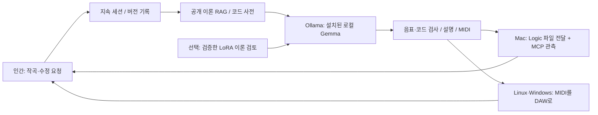

# 공개 음악 기초 자산과 반복 작곡

[English](foundation.md) · **한국어**

DeepChord의 공개 기초 자산은 교재와 독립적으로 작성한 **이론 카드 24개**, 반음·도수 공식 **32개**, 이를 12근음에 적용한 **코드 사전 384개**입니다. `src/sovereign_music/assets/foundation.toml`과 계산·검색 코드가 패키지에 포함됩니다. 책·계정·인터넷 없이 검색과 구성음 계산을 사용할 수 있습니다.

## 공개하는 자료

음계·음정·코드 구성 같은 일반 지식을 새로운 문장과 수식으로 정리했습니다. 특정 교재의 문장, OCR, 목차 배열·페이지 위치, 도표·악보·곡 예제는 가져오지 않았습니다. 기존 개인 교재 RAG는 여전히 별도의 선택 기능입니다. 단순히 책 문장을 바꾸거나 파일 이름을 바꿨다는 이유로 공개 대상으로 삼지 않습니다.

일반 아이디어·방법과 구체적 표현의 구별은 [미국 저작권청 안내](https://www.copyright.gov/help/faq/faq-protect.html)에서도 설명합니다. 공개 자산의 새 문장과 코드는 Apache-2.0으로 제공하지만, 음악 이론의 사실 자체를 프로젝트가 독점한다고 주장하지 않습니다. 다른 자료를 추가할 때에는 그 자료의 표현·편집·권리 조건을 별도로 검토하세요.

```sh
deepchord rag '장조 투파이브와 성부 연결'
deepchord chord 'Cdim7'
deepchord foundation --out /path/to/new/foundation
```

`foundation`은 동일한 원본에서 재현 가능한 `rag.jsonl`, `reviewed.jsonl`, 해시와 범위를 기록한 `manifest.json`을 만듭니다. 총 RAG 문서 408개와 한·영 학습 레코드 816개입니다. JSONL은 생성된 배포용 파일이며 소스 저장소에서는 검토하기 쉬운 TOML·수식을 관리합니다. 이 공개 자료로 만든 파일은 같은 라이선스 아래 공유할 수 있습니다. 개인 교재 자료와 섞인 색인·학습 데이터는 별도로 보관하세요.

감3화음 `dim`과 완전감7화음 `dim7`을 구별합니다. Cdim7은 C–Eb–Gb–Bbb이며 실음 Bbb와 A는 같아도 도수 철자는 다릅니다. 코드 사전은 모든 음을 동시에 연주하라는 지시가 아니고 텐션·배치 선택의 기초입니다. 슬래시 베이스와 임의 `alt`는 현재 계산 어휘 밖이며 지원하지 않는 기호는 오류로 반환합니다.

## 사람이 계속 주문하는 흐름



```sh
deepchord session --name my-song --model gemma4:12b-mlx --bars 4
# Mac에서 Logic 전달과 MCP 관측까지:
deepchord session --name my-song --model gemma4:12b-mlx --bars 4 \
  --logic --mcp-config /path/to/private/logic.toml
```

첫 요청으로 스케치를 만들고 다음 요청으로 직전 성공 버전을 수정합니다. `/quit`까지 대화를 계속하며 같은 이름으로 다시 시작하면 이어집니다. 각 성공 버전의 JSON·MIDI·근거·설명을 별도 폴더에 저장합니다. 실패한 요청은 기록하고 직전 성공 버전을 보존하므로 다음 주문을 계속할 수 있습니다. 모델이 원하는 수정만 정확히 바꿨는지는 사람이 결과를 검토해야 합니다.

- `/status`: 요청·실패·버전과 현재 원본 확인
- `/explain`: 최신 코드·구성음·검출 패턴 설명
- `/new`: 이전 버전을 보관하고 다음 요청을 새 곡으로 시작
- `/open`: 최신 버전을 Logic으로 다시 전달(Mac)
- `/quit`: 세션 저장 후 종료

자동 요청 목록은 `--request '첫 요청' --request '수정 요청'`으로 실행합니다. 대화형 명령은 세션 제어용이며 모델이 셸 명령이나 임의 MCP 도구를 실행하지 않습니다. CLI는 현재 1–16마디 피아노 스케치를 다루며, 완성곡의 편성·길이·음색·믹스 자동화를 완료한 상태는 아닙니다.

## 매번 설명하는 것

`EXPLANATION.md`와 `explanation.json`에는 마디별 코드·도수·구성음·실음 음급, 코드명에서 검출한 장·단조 ii–V–I와 도미넌트 근음 진행, 검색한 이론 후보와 화성 검사 경고를 기록합니다. 검색 후보는 실제 적용의 증명이 아닙니다. 검출 패턴은 코드명 관계에 대한 설명이며 청취 평가나 완전한 기능 분석이 아닙니다. JSON에서 수정한 뒤에는 `deepchord explain RUN`으로 다시 계산할 수 있습니다.

## RAG와 LoRA를 함께 사용

```sh
deepchord foundation --out /path/to/new/foundation
deepchord train prepare /path/to/new/foundation/reviewed.jsonl \
  --out /path/to/new/splits
# Apple Silicon Mac: 호환되는 로컬 MLX 모델
deepchord train run --backend mlx --model /path/to/local-mlx-model \
  --data /path/to/new/splits --out /path/to/new/adapter --iters 100
# Linux / Windows / macOS: 호환되는 비양자화 HF 모델과 선택 의존성
python -m pip install '.[train-portable]'
deepchord train run --backend transformers --model /path/to/local-hf-model \
  --data /path/to/new/splits --out /path/to/new/adapter --iters 100
```

학습은 카드·공식으로 검증한 이론 설명과 코드 구성음 질의응답을 사용합니다. 코드의 모든 이조와 언어 변형은 같은 코드 계열 그룹에 남고, 이론 한 개의 한·영 설명도 같은 그룹에 남습니다. 원본 그룹을 나눠 train/valid/test를 만들며, 문장 언어만 바꿔 테스트에 정답이 새는 것을 막습니다. 이 자료는 합성 사실 연습이고 창의적 작곡·청취 품질의 벤치마크가 아닙니다.

`--adapter`는 작곡 모델 자체에 학습된 어댑터를 적용합니다. **Ollama 작곡 모델을 유지하면서** 별도 로컬 LoRA로 이론을 검토하려면:

```sh
deepchord session --name my-song --model gemma4:12b-mlx \
  --theory-model /path/to/local-mlx-model --theory-adapter /path/to/adapter
```

LoRA 검토 응답은 `theory-review.json`에 미검증 제안으로 남기며 공식·결과 음표 검사를 대체하지 않습니다. MLX 어댑터를 Ollama 태그에 자동 주입하지 않습니다. 모델·어댑터·변환된 가중치는 제공하지 않으며, 베이스 모델과 백엔드의 호환성은 별도로 확인합니다. 학습 횟수와 손실만으로 음악적 개선을 주장하지 않습니다.

## 운영체제별 실제 범위

| 기능 | Linux | Windows | macOS |
|---|---|---|---|
| 공개 RAG·코드 사전·MIDI·설명·지속 세션 | 지원 | 지원 | 지원 |
| Ollama 로컬 작곡 | 설치 모델에 따라 | 설치 모델에 따라 | 설치 모델에 따라 |
| Transformers/PEFT LoRA | 선택 기능, 호환 HF 모델 | 선택 기능, 호환 HF 모델 | 선택 기능, 호환 HF 모델 |
| MLX LoRA 경로 | 이 프로젝트에서 미검증 | 미지원 | Apple Silicon에서 실행 확인 |
| 네이티브 Logic Pro / 로컬 Logic MCP | Mac으로 전달 | Mac으로 전달 | 지원 범위는 Logic 안내 참고 |

`gemma4:12b-mlx`는 개발 Mac에 설치된 태그이며 모든 운영체제의 공통 배포 태그가 아닙니다. 다른 운영체제에서는 `ollama list`로 실제 설치된 로컬 모델을 확인해 `--model`로 지정하세요. 클라우드 모델로 대체하지 않습니다. [Ollama Linux](https://docs.ollama.com/linux), [Windows](https://docs.ollama.com/windows), [Logic Pro for Mac](https://support.apple.com/guide/logicpro/welcome/mac).

Linux/macOS는 README의 가상 환경 명령을 사용하고, Windows PowerShell에서는 다음과 같이 설치합니다.

```powershell
git clone https://github.com/Sovereign-Music-Lab/DeepChord.git
cd DeepChord
py -3 -m venv .venv
.venv\Scripts\python.exe -m pip install .
.venv\Scripts\deepchord.exe doctor
.venv\Scripts\deepchord.exe session --name my-song --model YOUR_INSTALLED_LOCAL_MODEL
```

네이티브 Logic은 Mac에서 실행됩니다. 다른 운영체제에서는 `deepchord export RUN --out /path/to/new.mid`로 전체 MIDI를 내보내 DAW에 가져오거나 Mac에 전달하세요. Logic의 MIDI 열기 요청과 MCP 상태 관측은 가져오기·악기 배정·소리·프로젝트 저장을 모두 검증한 것과 다릅니다. 이 구분은 반복 세션에서도 유지합니다.
