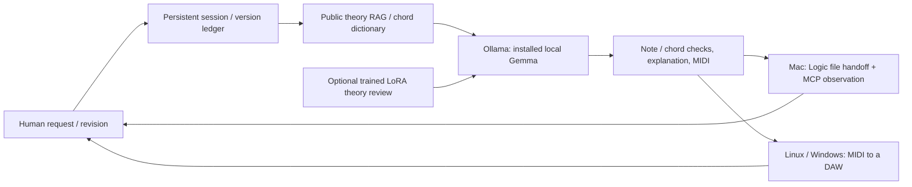

# Public music foundations and the continuing composition loop

**English** · [한국어](foundation.ko.md)

The public foundation contains **24 independently written theory cards**, **32 interval formulas**, and **384 chord entries** computed across twelve roots. The package includes `src/sovereign_music/assets/foundation.toml` and its calculation/retrieval code. Retrieval and chord lookup need no books, account, or network.

## What is public

Explanations and formulas express general knowledge in a new organization. No textbook wording, OCR, index order, page locators, diagrams, scores, or example pieces were imported. Private textbook RAG remains a separate optional provider. Renaming or paraphrasing a book does not by itself make it a public asset.

The [U.S. Copyright Office](https://www.copyright.gov/help/faq/faq-protect.html) explains the distinction between ideas or methods and their expression. New foundation wording and code use Apache-2.0; the project claims no exclusive ownership of music-theory facts. Review the expression, compilation, and rights of any additional material separately.

```sh
deepchord rag 'major ii-V-I and voice leading'
deepchord chord 'Cdim7'
deepchord foundation --out /path/to/new/foundation
```

The export deterministically creates `rag.jsonl`, `reviewed.jsonl`, and a hash/scope `manifest.json`: 408 retrieval records and 816 bilingual training records. The repository maintains their reviewable TOML/formula sources rather than generated JSONL. Exports of this public material can be shared under the same license. Keep indexes or datasets mixed with private book material separate.

`dim` means a diminished triad; `dim7` means a diminished seventh. Cdim7 spells C–Eb–Gb–Bbb. Its Bbb sounds like A but has a different degree spelling. The dictionary describes pitch collections, not an instruction to play every tone at once. Slash bass and arbitrary `alt` symbols are outside the current vocabulary and are refused.

## Keep requesting and revising



```sh
deepchord session --name my-song --model gemma4:12b-mlx --bars 4
# On a Mac, add Logic handoff and MCP observation:
deepchord session --name my-song --model gemma4:12b-mlx --bars 4 \
  --logic --mcp-config /path/to/private/logic.toml
```

The first request creates a sketch; subsequent requests revise the last successful version. Continue until `/quit`, and resume later with the same session name. Every successful version preserves separate JSON, MIDI, evidence, and explanations. Failed requests are recorded while retaining the last successful version. A person must still check that the model preserved decisions outside the requested change.

- `/status`: inspect requests, failures, versions, and current source.
- `/explain`: show the latest chord, tone, and detected-pattern report.
- `/new`: preserve history and start the next request as a new piece.
- `/open`: hand the latest version to Logic again, on a Mac.
- `/quit`: save and exit.

Use repeated `--request 'first request' --request 'revision'` arguments for a non-interactive list. Session commands control the application; model text never executes shell commands or arbitrary MCP tools. The CLI currently handles 1–16-bar piano sketches, not fully automated long-form orchestration, finished sound design, or mixing.

## What every result explains

`EXPLANATION.md` and `explanation.json` record each bar's chord, degrees, spelled tones, pitch classes, major/minor ii–V–I and dominant root-motion patterns detected in chord labels, retrieved theory candidates, and harmony-check warnings. A retrieved candidate is not proof of application. Pattern detection is not listening or complete functional analysis. Run `deepchord explain RUN` after editing JSON to recalculate the report.

## Use RAG and LoRA together

```sh
deepchord foundation --out /path/to/new/foundation
deepchord train prepare /path/to/new/foundation/reviewed.jsonl \
  --out /path/to/new/splits
# Apple Silicon Mac, compatible local MLX model:
deepchord train run --backend mlx --model /path/to/local-mlx-model \
  --data /path/to/new/splits --out /path/to/new/adapter --iters 100
# Linux / Windows / macOS, compatible unquantized HF model:
python -m pip install '.[train-portable]'
deepchord train run --backend transformers --model /path/to/local-hf-model \
  --data /path/to/new/splits --out /path/to/new/adapter --iters 100
```

Foundation training uses authored explanations and formula-checked chord Q&A. Transpositions and language variants stay in the same chord-family group; both languages of a theory card also remain together. Group-based train/valid/test separation avoids leaking a translated or transposed target into evaluation. Synthetic factual exercises are not a benchmark of creative composition or listening quality.

`--adapter` applies an adapter to the composition model itself. To **keep the Ollama composer** and consult a separate local LoRA theory reviewer:

```sh
deepchord session --name my-song --model gemma4:12b-mlx \
  --theory-model /path/to/local-mlx-model --theory-adapter /path/to/adapter
```

Reviewer output is saved in `theory-review.json` as an unverified proposal, not a replacement for formula and event checks. MLX adapters are not automatically injected into Ollama tags. Models, adapters, and converted weights are not distributed; verify base-model/backend compatibility separately. Training steps and loss alone do not establish musical improvement.

## Platform scope

| Feature | Linux | Windows | macOS |
|---|---|---|---|
| Public RAG, chords, MIDI, explanations, sessions | Supported | Supported | Supported |
| Local Ollama composition | Depends on installed model | Depends on installed model | Depends on installed model |
| Transformers/PEFT LoRA | Optional, compatible HF model | Optional, compatible HF model | Optional, compatible HF model |
| MLX LoRA path | Unqualified in this project | Unsupported | Exercised on Apple Silicon |
| Native Logic / local Logic MCP | Transfer to a Mac | Transfer to a Mac | See Logic guide for boundaries |

`gemma4:12b-mlx` is a tag installed on the development Mac, not a universal distribution tag. Elsewhere, inspect `ollama list` and supply an installed local model with `--model`; no cloud model is substituted. See [Ollama Linux](https://docs.ollama.com/linux), [Windows](https://docs.ollama.com/windows), and [Logic Pro for Mac](https://support.apple.com/guide/logicpro/welcome/mac).

Use the README's virtual-environment commands on Linux/macOS. Windows PowerShell:

```powershell
git clone https://github.com/Sovereign-Music-Lab/DeepChord.git
cd DeepChord
py -3 -m venv .venv
.venv\Scripts\python.exe -m pip install .
.venv\Scripts\deepchord.exe doctor
.venv\Scripts\deepchord.exe session --name my-song --model YOUR_INSTALLED_LOCAL_MODEL
```

Native Logic runs on a Mac. Elsewhere, use `deepchord export RUN --out /path/to/new.mid` and import the full MIDI into a DAW or transfer it to a Mac. A Logic open request plus MCP observation does not verify import, instruments, sound, and project saving. Repeated sessions preserve that distinction.
